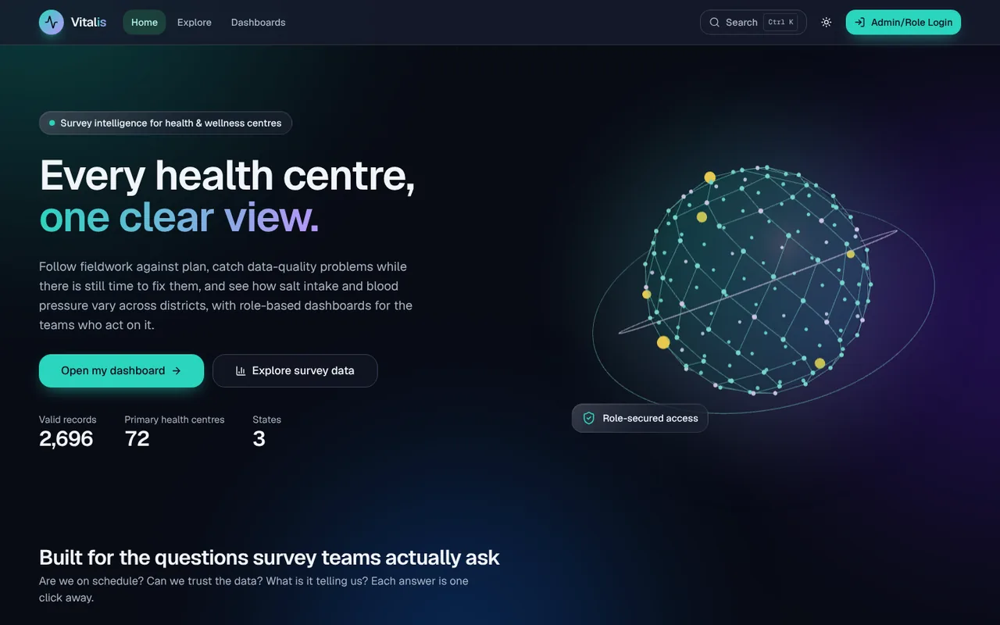
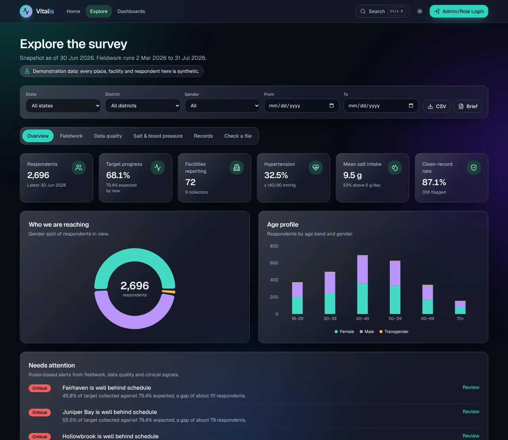
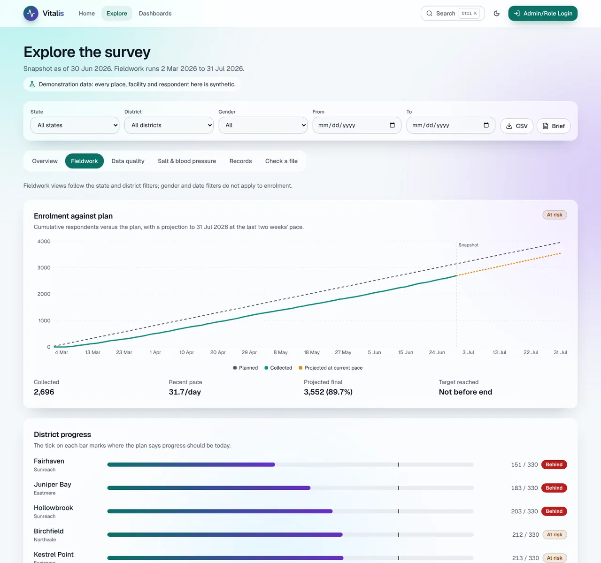
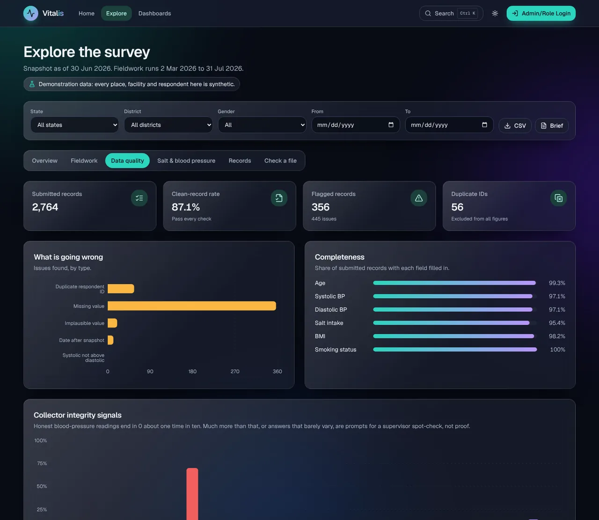
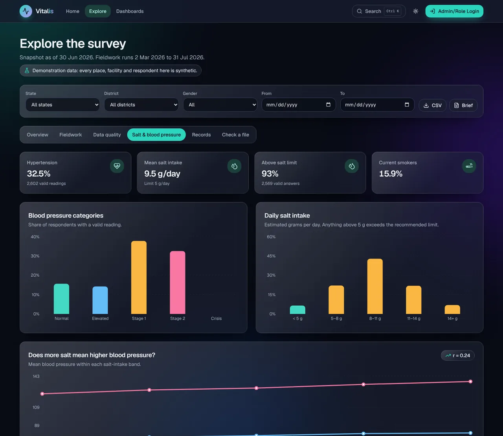
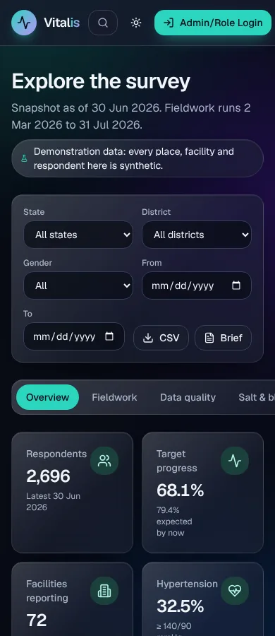

# Vitalis

Survey intelligence for health and wellness centres: follow fieldwork against plan, catch data-quality problems while
they can still be fixed, and see how blood pressure and salt intake vary across districts.

[](https://github.com/Sandeepsrinivasan-14/vitalis-survey-intelligence/actions/workflows/ci.yml)
[](LICENSE)

> **Everything in this repository is synthetic.** The states, districts, facilities and respondents are generated and
> fictional, and the app contains no real survey data.

| Landing                                              | Survey overview                                            |
| ---------------------------------------------------- | ---------------------------------------------------------- |
|   |     |

| Fieldwork forecast                                       | Data quality                                         |
| -------------------------------------------------------- | ---------------------------------------------------- |
|  |  |

| Salt and blood pressure                                | Mobile                                                   |
| ------------------------------------------------------ | -------------------------------------------------------- |
|  |  |

## What it does

**Survey explorer** (`/explore`, public) with filters for state, district, gender and date range that live in the URL,
so any view can be shared as a link.

- **Overview**: headline KPIs, gender split, age profile and a ranked list of alerts.
- **Fieldwork**: cumulative enrolment against plan with a projected finish from the last two weeks of pace, a status
  for every district, facilities that have gone quiet, and a collector leaderboard.
- **Data quality**: duplicates, missing values, implausible values, future dates and inconsistent blood pressure,
  counted by type and by district, plus field completeness.
- **Collector integrity signals**: last-digit preference in blood-pressure readings, suspiciously uniform answers and
  unusual pace, as prompts for a supervisor spot-check.
- **Salt and blood pressure**: blood-pressure categories, salt-intake bands, mean pressure by salt band with the
  correlation coefficient, and district hotspots.
- **Records**: searchable, sortable, paginated table. Respondents are identified by an ID only; there are no names.
- **Check a file**: drop in a CSV and run the same quality checks in the browser. Nothing is uploaded.
- **Executive brief** (`/explore/report`): a one-page situation report written from the numbers, printable to PDF.
- **CSV export** of the filtered records, protected against spreadsheet formula injection.
- **Command palette** (Ctrl/Cmd + K) for navigation, state filters and theme.

**Role dashboards** (`/facility`, `/district`, `/state`, `/admin`) behind server-side authentication: staff upload
CSV or Excel files and get status summaries, progress to target, trend charts and optional AI trend analysis.

## How the analytics work

All analytics are pure, typed functions in `src/lib/survey/` with no framework dependencies, covered by unit tests.

| Module            | Responsibility                                                                                          |
| ----------------- | ------------------------------------------------------------------------------------------------------- |
| `generate.ts`     | Deterministic synthetic survey (seeded), with realistic fieldwork problems injected on purpose          |
| `analysis-set.ts` | The records figures are computed from: first occurrence of each ID, nothing dated after the snapshot    |
| `filters.ts`      | Parses and validates URL filters, applies them, and serialises them back                                |
| `stats.ts`        | Blood-pressure categories, hypertension rate, salt bands, Pearson correlation, age bands, roll-ups      |
| `progress.ts`     | Planned versus actual burn-up, linear forecast, district status, facilities needing attention          |
| `quality.ts`      | Record-level checks and the clean-record rate                                                           |
| `collectors.ts`   | Per-collector pace and integrity signals                                                                |
| `alerts.ts`       | Rule-based alerts, ordered by severity                                                                  |
| `briefing.ts`     | Plain-language situation report from fixed rules, so it is repeatable and needs no AI service           |
| `csv.ts`          | CSV export and tolerant parsing of uploaded files                                                       |

Definitions worth knowing:

- **Hypertension** is a systolic reading of 140 mmHg or more, or diastolic of 90 or more, among respondents with a
  valid reading. Readings outside plausible ranges, or with systolic not above diastolic, are excluded.
- **Salt limit**: 5 g per day. Intake is an estimate in grams per day.
- **Forecast**: the last 14 working days' average pace, projected across the remaining working days (Monday to
  Saturday). Status is *on track* at 98% of target or more, *at risk* at 85% or more, otherwise *behind*.
- **District status** compares progress with where the plan says it should be today: on track at 95% of expected or
  more, at risk at 80% or more, otherwise behind.
- **Digit preference**: honest systolic readings end in 0 about one time in ten. A collector is flagged at 30% or more
  (with at least 30 readings).
- The salt–pressure relationship is an association in this survey, not proof of cause. The app says so.


## Getting started

### Prerequisites

- Node.js 20 (see `.nvmrc`) and npm 10+

### Setup

```bash
git clone https://github.com/Sandeepsrinivasan-14/vitalis-survey-intelligence.git
cd vitalis-survey-intelligence
npm ci
npm run setup:env   # writes .env.local: fresh AUTH_SECRET + one random-password account per role
npm run dev         # http://localhost:9002
```

`npm run setup:env` prints the generated passwords **once**; only their scrypt hashes are written to `.env.local`. It
refuses to overwrite an existing file unless you pass `-- --force`. Sign in at <http://localhost:9002/login>, or open
<http://localhost:9002/roles> and pick a role.

### Environment variables

All variables are documented in [`.env.example`](.env.example). Real `.env*` files are git-ignored.

| Variable                | Required | Scope  | Description                                                                                                                                                  |
| ----------------------- | -------- | ------ | ------------------------------------------------------------------------------------------------------------------------------------------------------------ |
| `AUTH_SECRET`           | **Yes**  | Server | Secret (at least 32 characters) used to sign the session cookie, e.g. `openssl rand -base64 48`. There is no fallback; sign-in fails closed without it.       |
| `AUTH_USERS`            | **Yes**  | Server | JSON array of `{ "email", "role", "passwordHash" }`. `role` is `facility`, `district`, `state` or `admin`. Create hashes with `npm run hash-password -- "…"`. |
| `GEMINI_API_KEY`        | No       | Server | Google AI (Gemini) key for live AI analysis. Without it the analysis returns a rule-based summary.                                                            |
| `AI_MODE`               | No       | Server | `auto` (default: live when a key is set), `live` or `demo`.                                                                                                   |
| `AI_RATE_LIMIT_PER_MIN` | No       | Server | AI requests allowed per user per minute (default 12).                                                                                                         |
| `NEXT_PUBLIC_SITE_URL`  | No       | Public | Canonical URL (no trailing slash) for metadata, Open Graph, `robots.txt` and `sitemap.xml`. Default `http://localhost:9002`. Set it **at build time**.        |

Wrap `AUTH_USERS` in single quotes in env files, and keep it on one line. Never expose server variables with a
`NEXT_PUBLIC_` prefix.

## Authentication and roles

| Role                 | Home                  | Can also open                    |
| -------------------- | --------------------- | -------------------------------- |
| Facility Manager     | `/facility/dashboard` | –                                |
| District Officer     | `/district/dashboard` | facility                         |
| State Admin          | `/state/dashboard`    | district, facility               |
| Website Manager (IT) | `/admin/dashboard`    | – (least privilege, own page only) |

- `src/app/auth-actions.ts` – login/logout server actions. Credentials are checked against `AUTH_USERS` with a
  constant-time scrypt comparison; failures return one uniform message; logins are rate-limited (8 attempts per 5
  minutes per email + client); post-login redirects only accept same-site paths the role may open.
- `src/lib/auth/token.ts` / `session.ts` – HS256-signed session (`vitalis_session`) stored in an `httpOnly`,
  `SameSite=Lax` cookie (`Secure` in production) that expires after 8 hours.
- `src/middleware.ts` – guards `/facility`, `/district`, `/state` and `/admin`: anonymous visitors are sent to `/login`,
  signed-in users opening a dashboard outside their permissions are redirected to their own, and protected responses
  are marked `Cache-Control: private, no-store`.
- `src/app/actions.ts` – the AI server action re-checks the session and applies a per-user rate limit and input-size
  limits before calling Gemini.

The old duplicate role routes (`/district-officer`, `/facility-manager`, `/state-admin`, `/website-manager`,
`/authenticated-dashboard`) are permanent redirects to the canonical pages.

## Uploading data

Each dashboard accepts `.csv`, `.xlsx` and `.xls` files up to 10 MB. Download a starter file from the **CSV template**
button (served from `public/templates/<role>-template.csv`). Columns are matched case-insensitively with per-role
synonyms (`src/lib/uploads/transform.ts`, `profiles.ts`); the core columns are `category`, `indicator name`, `value`,
`unit`, `target`, `previous value`, `status`, `trend` and `date`. Rows that cannot be read are skipped with a notice. Data is parsed in the browser and
kept in memory only.

## UI and accessibility

- Glass cards (backdrop blur, translucent layers, gradient borders) over an animated mesh-gradient background.
- Light, dark and system themes with a toggle in the header; the theme colour meta tag follows the scheme.
- The 3D globe is loaded only on the client, when the hero is visible and the browser is idle, and only if WebGL is
  available; otherwise a CSS 3D orb is shown. With `prefers-reduced-motion` the globe renders a single still frame and
  all framer-motion and CSS animations are disabled.
- Skeleton loaders while files are processed and for route loading, empty and error states throughout.
- Skip link, landmarks, labelled form controls and charts, visible focus rings, colour pairs chosen for WCAG AA
  contrast in both themes, and layouts tested at 390 px (mobile) and 1440 px (desktop).

## Scripts

| Script                               | What it does                                                    |
| ------------------------------------ | --------------------------------------------------------------- |
| `npm run dev`                        | Dev server (Turbopack) on port 9002                             |
| `npm run build`                      | Production build (type and lint errors fail the build)          |
| `npm start`                          | Serve the production build (port 3000, override with `PORT`)    |
| `npm run lint`                       | ESLint via `next lint`                                          |
| `npm run typecheck`                  | `tsc --noEmit`                                                  |
| `npm test`                           | Vitest suite once (`test:watch`, `test:coverage` also available) |
| `npm run ci`                         | lint + typecheck + tests + build, the same gates as CI          |
| `npm run setup:env`                  | Generate a local `.env.local` with dev accounts                 |
| `npm run hash-password -- "<pass>"`  | Print an scrypt hash for an `AUTH_USERS` entry                  |
| `npm run genkit:dev`                 | Genkit developer UI for the AI flow                             |

## Project structure

```
.
├── .github/                    CI workflow, Dependabot config, PR template
├── docs/                       Product blueprint and README screenshots
├── public/templates/           CSV upload templates per role
├── scripts/                    setup-env.ts, hash-password.ts
├── src/
│   ├── ai/                     Genkit setup and the analyze-health-trends flow
│   ├── app/
│   │   ├── page.tsx            Public landing page (/)
│   │   ├── explore/            Survey explorer (/explore), CSV export and printable brief
│   │   ├── login/              Sign-in page
│   │   ├── roles/              Role picker
│   │   ├── facility/ district/ state/ admin/   Role dashboards (/<role>/dashboard)
│   │   ├── auth-actions.ts     Login / logout server actions
│   │   ├── actions.ts          AI analysis server action
│   │   └── error, global-error, not-found, loading, robots, sitemap
│   ├── components/
│   │   ├── explore/            Explorer tabs, charts, filter bar and the in-browser file checker
│   │   ├── landing/            Hero, 3D scene, feature grid, survey overview and charts
│   │   ├── dashboard/          Shared role dashboard, charts, metric cards, uploader, AI analysis
│   │   ├── layout/             App shell, command palette, mesh background, theme toggle
│   │   ├── motion/             Reveal / stagger and animated-number helpers
│   │   └── ui/                 Radix-based primitives (shadcn/ui style)
│   ├── data/mock-data.ts       Landing-page figures (derived from the survey engine) and role-dashboard samples
│   ├── lib/
│   │   ├── survey/             Synthetic survey generator and every analytics module (see below)
│   │   └── auth/, uploads/, rate limiting, AI mode, dashboard stats, site constants
│   ├── middleware.ts           Role guards
│   └── types/
├── next.config.ts              Security headers, redirects
└── vitest.config.mts
```

Tests live next to the code they cover (`*.test.ts(x)`), with auth helpers tested in `src/lib/__tests__/`.

## Quality gates

CI (`.github/workflows/ci.yml`) runs on pushes and pull requests to `master`: `npm ci`, lint, typecheck, tests and a
production build, plus an `npm audit` job. Dependabot opens weekly update PRs for npm packages and GitHub Actions.

## Security

- Content-Security-Policy, `Strict-Transport-Security`, `X-Frame-Options: DENY`, `X-Content-Type-Options`,
  `Referrer-Policy` and `Permissions-Policy` headers; `X-Powered-By` disabled. The CSP allows inline scripts and styles
  (needed by Next.js without nonce middleware); per-request nonces are a possible follow-up.
- No credentials in the repository: accounts and the signing secret come only from the environment.
- Rate limiting is in-memory per server instance. Behind several instances, put a shared store (e.g. Redis) or an edge
  rate limiter in front.

## Deployment

Any platform that runs Node.js works (Vercel, Firebase App Hosting, Docker, a VM). Set `AUTH_SECRET`, `AUTH_USERS`,
`NEXT_PUBLIC_SITE_URL` and optionally `GEMINI_API_KEY`, then build with `npm run build`.

```bash
npm ci
NEXT_PUBLIC_SITE_URL=https://your.domain npm run build
AUTH_SECRET=... AUTH_USERS='[...]' GEMINI_API_KEY=... npm start
```

Serve over HTTPS in production: the session cookie is marked `Secure`.

## Known limitations

- **Demonstration data only.** The explorer runs on a generated survey of fictional places. There is no database and no
  way to load a real survey into the explorer yet; the file checker validates a CSV in the browser but does not store it.
- The explorer is public by design because it contains no real data. Put it behind the existing role middleware before
  pointing it at anything real.
- Users are managed through the `AUTH_USERS` variable; there is no self-service sign-up or password reset.
- The clinical roles share one sample dataset; the IT role has its own system sample.
- The collector signals (rounded readings, uniform answers, unusual pace) are screening prompts. Honest teams can trip
  them, so they point a supervisor at where to look rather than finding anyone at fault.
- The `xlsx` (SheetJS) package on npm (0.18.5) has known advisories and no fixed npm release. It is only used in the
  browser by the role-dashboard uploader to read a file the signed-in user chooses; replace it before accepting files
  from untrusted sources. `npm audit` also reports advisories in transitive Firebase and Genkit dependencies.
